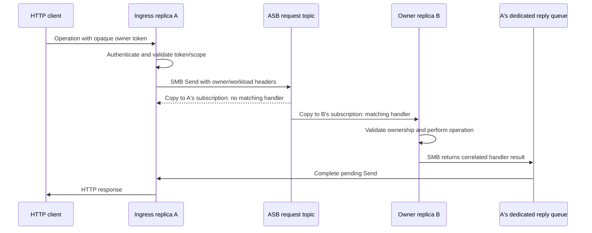

# SlimMessageBus and Azure Service Bus patterns for Azure Container Apps

This guide describes owner-addressed requests, owner-addressed background work, and dedicated per-process reply queues. It is useful when an application running on Azure Container Apps (ACA) keeps an intentionally ephemeral workspace, cache, or execution context on one replica, while HTTP requests can arrive at any replica.

These are application patterns built on SlimMessageBus (SMB) and Azure Service Bus (ASB), not a separate distributed-state feature of SMB. The application owns its identity model, authorization, local state, operation receipts, and recovery rules.

## Problems this solves with ACA

| Problem | Pattern |
| --- | --- |
| A later HTTP request reaches a different replica from the one holding local state. | Accept ingress on any replica, then forward to the state owner through SMB request/response. |
| Different replicas need to address an owning process without maintaining direct replica addresses. | Use a logical process identity in message headers and a private subscription per process. |
| An HTTP operation starts work that can exceed the HTTP timeout. | Return an operation receipt after enqueueing; perform the work in an independent ASB consumer and expose status polling. |
| Shared reply consumers could deliver a response to a process that does not hold the pending request. | Give each requesting process its own reply queue and let SMB handle reply destinations and correlation. |
| Deployments and restarts leave temporary broker entities behind. | Give temporary queues/subscriptions idle auto-deletion and use a new identity for every process lifetime. |
| Too many expensive jobs can run simultaneously on one replica. | Set ASB processor concurrency separately for short requests and long-running jobs. |

ACA HTTP session affinity uses cookies, is available in single-revision HTTP mode, and can route a client to another replica when the former replica is unavailable. It is not a durable ownership contract. This pattern does not depend on those cookies or direct process addresses. ACA revision traffic rules select revisions; application state ownership still needs its own process identity. See Microsoft's [session affinity](https://learn.microsoft.com/en-us/azure/container-apps/sticky-sessions) and [revisions](https://learn.microsoft.com/en-us/azure/container-apps/revisions) documentation.

## Topology and identities

Example names, using one common workload prefix:

| Entity | Example | Lifetime |
| --- | --- | --- |
| Shared request topic | `authoring/workspaces-requests` | Workload |
| Request subscription | `request-{processId}` | Process |
| Shared background-job topic | `authoring/workspaces-jobs` | Workload |
| Job subscription | `job-{processId}` | Process |
| Dedicated reply queue | `authoring/workspaces-replies/{processId}` | Requesting process |

Topics provide a copy to each subscription. A **shared subscription would create competing consumers**, so the wrong replica could consume and complete work intended for an owner. Each process therefore has its own request/job subscriptions. Each sender has its own reply queue; replies do not need to fan out.

Generate the process identity once at startup, for example `Guid.NewGuid().ToString("N")`. Do not generate it per message or use a reusable hostname as its only identity. A restart must not accidentally claim an earlier process's lost local state. Include a workload identity as well, so independently configured workloads cannot accept each other's messages accidentally.

An application's opaque workspace/session token can bind process identity, resource ID, tenant/environment, authorization scope and expiry. Sign or encrypt it if it crosses an untrusted boundary. Routing headers alone are never authorization.

## Pattern 1: route a short operation to its owner



If ingress is already the owner, it can call the same application operation locally. Otherwise it sends an owner-addressed request through SMB. The application chooses this fast path; SMB does not infer local ownership.

Use the native handler/consumer `.Filter((headers, transportMessage) => ...)` to match owner and workload. This design deliberately uses application-side filtering, not ASB subscription SQL/correlation rules. Nonmatching replicas must not execute business logic or produce a synthetic response. Configure unmatched-message handling deliberately: a normal fan-out nonmatch should not become a retry loop or warning flood.

For the owner, validate the token, current process identity, resource lifetime, caller scope and revision/hash guards again. Filtering selects a handler; it does not replace those checks.

### Dedicated reply queues

Configure `ExpectRequestResponses` with `ReplyToQueue` and a name derived from the common workload prefix plus the startup identity. SMB supplies the request/reply metadata and routes the handler's returned result to the sender's configured queue. Application handlers should return their response normally, rather than implementing another response-publishing protocol.

The pending request and its correlation state belong to the sender's live process. If the sender restarts, a queued reply does not resurrect its lost HTTP request. Use application operation IDs to inspect/reconcile uncertain outcomes.

## Pattern 2: long-running work through a topic/subscription

Once a request reaches its owner, the owner can publish a separate background-job message targeting itself:

1. Validate the requested operation and expected source revision.
2. Register a caller-supplied operation/request ID and an initial queued receipt.
3. Publish an owner-addressed job through SMB to the jobs topic.
4. Return an operation ID promptly, usually as HTTP `202 Accepted`.
5. The owner's independent job consumer obtains its per-message DI scope and performs the work.
6. Poll a short status operation using that operation ID; bounded waits can reduce polling frequency.

The HTTP request, the request/reply handler and the long-running job have different lifetimes. Do not hold the original HTTP cancellation token for background execution. Use the consumer cancellation token, an application job deadline and any authorization/workspace expiry. Configure lock renewal for the intended job duration, and handle shutdown or lock loss explicitly.

This additional topic/subscription keeps work in the broker-managed processing path even when ingress already reached the owner. It allows independent processor concurrency, delivery/retry/dead-letter inspection and execution beyond the initiating HTTP request's lifetime. It is a consumer in the existing application process, not automatically an ACA Job or a new container.

ASB exposes delivery, active/dead-letter messages and queue/subscription metrics. Detailed compilation phases, percentage progress and business completion remain application telemetry or operation-status data. An empty broker queue is not proof that an operation succeeded.

## Configuration example

The following illustrates the topology. `OwnerRequestHandler` and `OwnerJobConsumer` are application-owned implementations. The header names are illustrative application metadata, not mandatory SMB names. Configure credentials through normal application configuration; do not put credentials in the owner token or message headers.

```csharp
const string prefix = "authoring/workspaces";
const string ownerHeader = "owner-instance-id";
const string workloadHeader = "workload-id";
const string workload = "workspace-authoring";
var processId = Guid.NewGuid().ToString("N"); // Once per process startup.
var jobsTopic = $"{prefix}-jobs";

bool IsOwner(IReadOnlyDictionary<string, object> headers)
    => headers.TryGetValue(ownerHeader, out var owner)
        && owner is string id && id == processId
        && headers.TryGetValue(workloadHeader, out var value)
        && value is string name && name == workload;

services.AddSlimMessageBus(bus =>
{
    bus.WithProviderServiceBus(settings =>
    {
        settings.ConnectionString = configuration["Bus:ConnectionString"];
        settings.TopologyProvisioning.Enabled = true;
        var factory = settings.ProcessorOptionsFactory;
        settings.ProcessorOptionsFactory = parameters =>
        {
            var options = factory(parameters);
            options.MaxConcurrentCalls = parameters.Path == jobsTopic ? 2 : 16;
            return options;
        };
    });
    bus.AddJsonSerializer();
    bus.Produce<OwnerRequest>(producer => producer.DefaultTopic($"{prefix}-requests"));
    bus.Produce<OwnerJob>(producer => producer.DefaultTopic(jobsTopic));

    bus.Handle<OwnerRequest, OperationReply>(handler =>
    {
        handler.Topic($"{prefix}-requests")
            .SubscriptionName($"request-{processId}")
            .WithHandler<OwnerRequestHandler>()
            .Filter((headers, _) => IsOwner(headers))
            .CreateSubscriptionOptions(options =>
            {
                options.AutoDeleteOnIdle = TimeSpan.FromHours(1);
                options.DefaultMessageTimeToLive = TimeSpan.FromMinutes(2);
            });
        handler.ConsumerSettings.UndeclaredMessageType.Fail = false;
        handler.ConsumerSettings.UndeclaredMessageType.Log = false;
    });

    bus.Consume<OwnerJob>(consumer =>
    {
        consumer.Topic(jobsTopic)
            .SubscriptionName($"job-{processId}")
            .WithConsumer<OwnerJobConsumer>()
            .Filter((headers, _) => IsOwner(headers))
            .MaxAutoLockRenewalDuration(TimeSpan.FromMinutes(30))
            .CreateSubscriptionOptions(options =>
            {
                options.AutoDeleteOnIdle = TimeSpan.FromHours(1);
                options.DefaultMessageTimeToLive = TimeSpan.FromHours(1);
            });
        consumer.ConsumerSettings.UndeclaredMessageType.Fail = false;
        consumer.ConsumerSettings.UndeclaredMessageType.Log = false;
    });

    bus.ExpectRequestResponses(reply => reply
        .ReplyToQueue($"{prefix}-replies/{processId}")
        .DefaultTimeout(TimeSpan.FromMinutes(2))
        .CreateQueueOptions(options =>
        {
            options.AutoDeleteOnIdle = TimeSpan.FromHours(1);
            options.DefaultMessageTimeToLive = TimeSpan.FromMinutes(2);
        }));
});
```

The sender supplies the verified owner's identity and workload in its request/job headers. A common ambient-context producer interceptor can populate these instead; use one propagation mechanism rather than copying the same context into both headers and business payloads. Tenant/environment, identity and correlation propagation should remain in shared infrastructure, with their independent validation rules.

`MaxConcurrentCalls` is a per-processor/per-process setting. Two active processes with a limit of two can run up to four jobs overall if both own work. It is not a namespace-wide concurrency limit. Set application budgets for disk, memory, CPU and workspace count too. Session-enabled subscriptions have additional concurrency/session settings; the example does not enable ASB sessions.

This code uses the API shape available in SMB 3.4.0. For package references, imports, provider setup and alternative topology options, see [Azure Service Bus provider](provider_azure_servicebus.md) and [request/response](UseCases/RequestResponse.md). No custom ownership interceptor is required.

## Reliability and recovery rules

- **Use application idempotency.** Retries and redelivery are possible. Keep a request ID plus argument fingerprint, reject ID reuse with different arguments, and serialize conflicting mutations. A live owner's deduplication ledger is not an exactly-once guarantee across process failure.
- **Distinguish queue acknowledgement from execution.** If enqueue acknowledgement is uncertain, preserve the operation ID and allow an identical retry. Never claim that a timeout means no mutation occurred.
- **Separate durable from staged state.** Persist at explicit checkpoints/build/publication boundaries. A broker message can survive its owner while the referenced local files or in-memory operation entry do not.
- **Fail explicitly on owner loss.** A newly started replica must not silently adopt an old startup identity or create a replacement workspace under an old token. Reopen from the last durable checkpoint and repeat or reconcile work explicitly.
- **Protect shared writes.** Use durable writer leases, ETags, revisions and source hashes where needed. A routing predicate alone does not prevent another authoring path from changing the persisted resource.
- **Publish only verified results.** Distinguish queued, running, failed and completed states. Validate ownership and source/build identity before saving a result into a published definition.
- **Bound lifetimes.** Distinguish send timeout, message TTL, lock renewal, operation deadline, owner-token expiry and broker entity idle lifetime. These settings solve different problems.

## ACA scaling, shutdown and operational limits

This solves logical routing, not replica persistence. ACA can replace or scale in a replica during work. Higher minimum replica counts do not pin a particular owning process. Stop admitting new work before shutdown, allow bounded draining, and record/return uncertainty when work is interrupted; never assume graceful termination can cover an arbitrarily long job.

Adding replicas helps new independent assignments, but cannot execute an existing owner's local workspace elsewhere. Do not treat the sum of fan-out subscription backlogs as freely distributable work: nonowner copies and abandoned subscriptions can distort that signal. Per-startup dynamic entity names also need an explicit scaling/monitoring plan. See [ACA scaling](https://learn.microsoft.com/en-us/azure/container-apps/scale-app).

Fan-out costs grow with the number of process subscriptions. Client-side filters still receive nonmatching copies; they do not save broker delivery or network cost. This is appropriate for a bounded replica count and a deliberate topology tradeoff. For larger fleets, consider broker-side routing rules, partitioned ownership or durable workers if their operational complexity is justified.

Temporary entities need suitable management permissions when automatic topology provisioning is enabled. Queue/subscription creation options apply when entities are created, not as a general migration mechanism. Keep shared topics stable; use idle auto-deletion on per-process subscriptions and reply queues. Idle cleanup is broker-defined, not an application session timeout or exact deletion schedule. Monitor abandoned entities, expired messages, dead-letter counts and entity quotas. See [Service Bus expiration and temporary entities](https://learn.microsoft.com/en-us/azure/service-bus-messaging/message-expiration).

Start the reply receiver and owner consumers before advertising readiness or returning owner tokens. Log operation/request IDs, workload, revision, duration and outcome; avoid logging opaque tokens or sensitive context values. In multi-revision deployments, retain compatible contracts and owner-token keys while old owners may still receive broker requests. HTTP revision traffic switching does not by itself stop those consumers.

## Deployment validation checklist

1. Start two replicas and verify distinct request/job subscriptions and dedicated reply queues under the same workload prefix.
2. Create local state on replica B; route an operation through A. Confirm only B's matching handler executes and only A's reply queue receives the result.
3. Send wrong/missing owner or workload headers. Verify nonmatches produce no business mutation or synthetic reply; verify independent authorization rejection on the matching owner.
4. Enqueue a long-running job, close the initiating HTTP connection, then poll from another ingress replica. Check concurrency and lock-renewal behavior.
5. Repeat identical operation IDs; simulate a lost enqueue/reply acknowledgement. Confirm no duplicate local mutation on a live owner.
6. Restart/scale in the owner and restart a requester. Verify explicit loss/uncertainty rather than transparent adoption or false success.
7. Check entity idle cleanup, TTL/dead-letter behavior, readiness, shutdown draining, and old-revision compatibility under real deployment conditions.

Unit tests and in-memory SMB tests can verify filters, interceptor scopes, correlation and idempotency logic. They do not establish real ASB fan-out, provisioning permissions, lock renewal or ACA lifecycle behavior.
